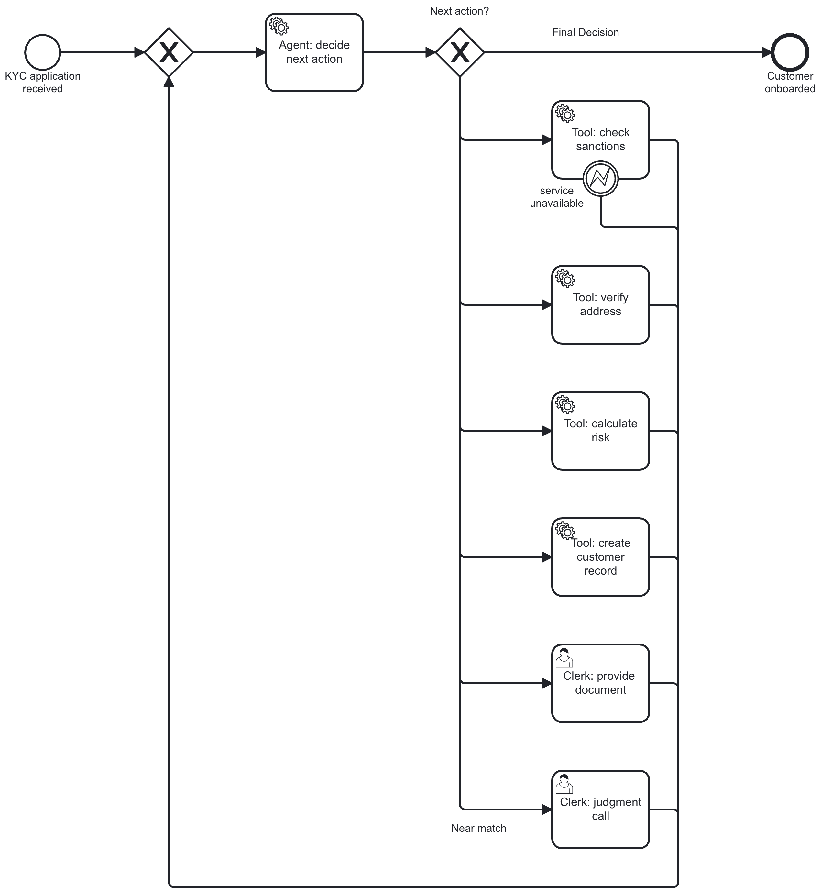
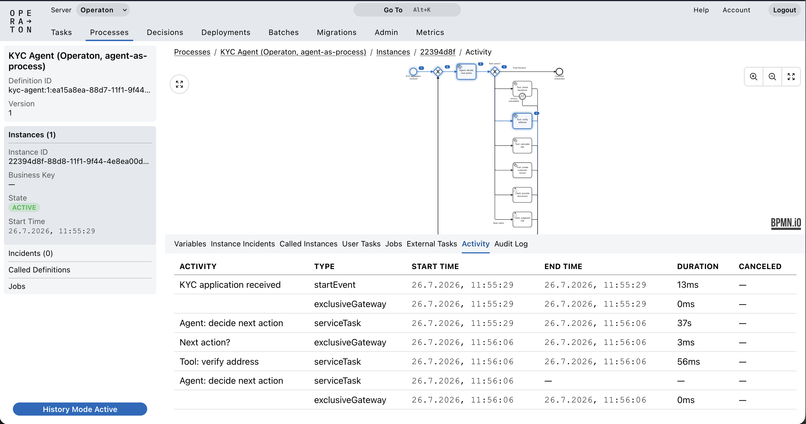
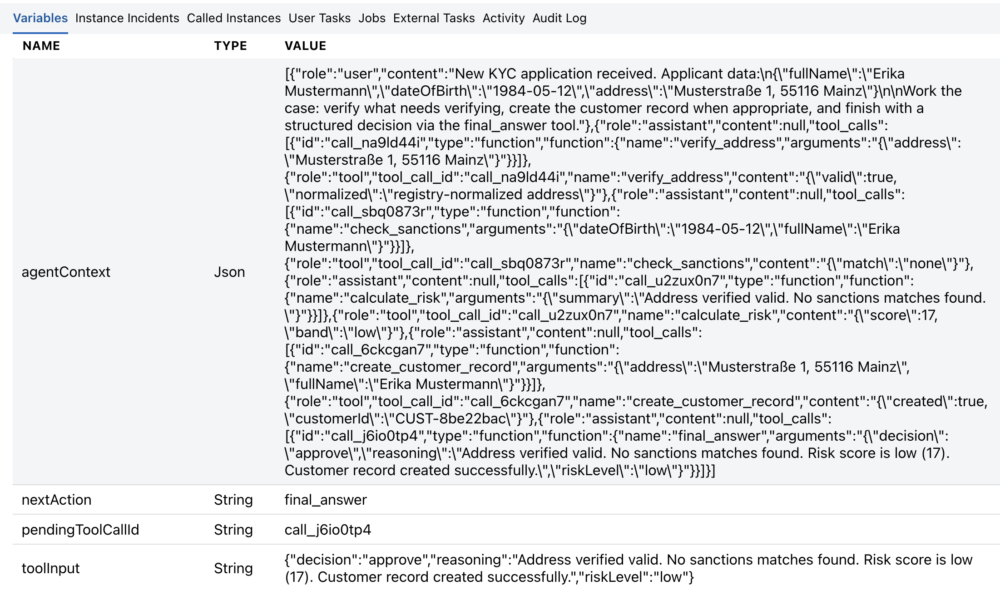
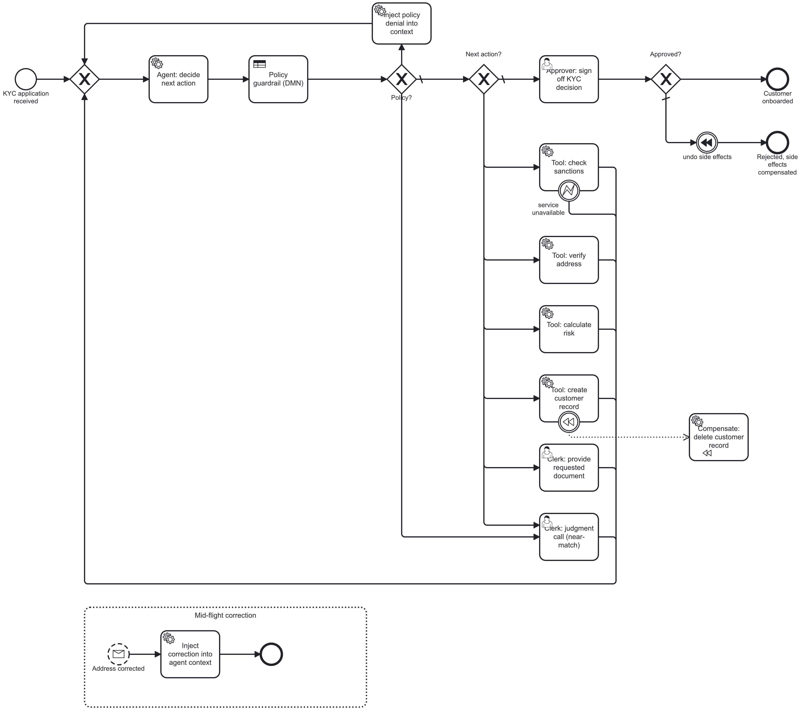
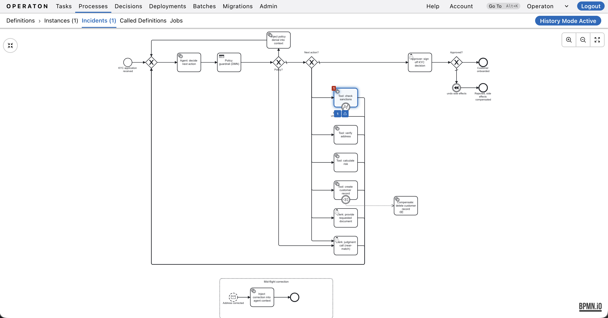
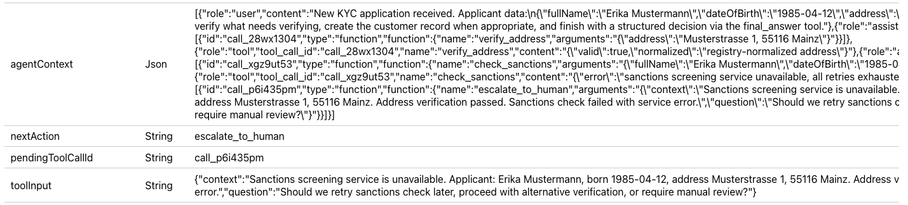

Last week I read the
article [What Native Agentic Architecture Actually Looks Like](https://berndruecker.io/what-native-agentic-architecture-actually-looks-like/)
by Bernd Rücker. It did a great job of showcasing the native agentic implementation in Camunda 8. Their teams put a lot
of work in agentic process orchestration and I think they provided a great user experience. However, while reading the
comparison to the "bolt-on" approach with
their Camunda 7 engine, whose community edition has reached end-of-life, I had the feeling that this could be solved
more elegantly, without any native engine features for LLM agents.

Since we have started working on our Camunda 7 CE fork, [Operaton](https://operaton.org/), in 2024 we were approached
almost monthly with the
question if we planned integrating AI features into the process engine. My answer was that the engine is extensible and
can call Java code (and polyglot
code via external task workers), so there was no need to implement specific technologies into the engine. Bernds blog
post seems to contradict this opinion –
what if we are only able to "bolt on" agentic workers, opposed to Camunda 8 with its native orchestration? It prompted
me to build my own KYC-process in Operaton
to see whether the properties the article attributes to native orchestration — step-level retries, incidents an operator
can resolve, a clickable audit trail, mid-flight input to a running agent — can be reproduced with plain BPMN, without
modifying the engine.

## A single agent call opposes the philosophy of BPMN

We model runnable BPMN processes to create transparency. Transparency for the business experts who have a deep knowledge
of the processes, and can see how their requirements are modeled. Transparency for the software developers, who can be
certain that the model they deploy to a process engine will be the base of the execution and the runtime will not
deviate.
Transparency for administrators, who can see incidents in the engine and can see which parts of a process were already
executed. Transparency for auditors, who need to know which parts of a process where executed at which point in time -
and why some decisions were made.
In the BPMN and Operaton trainings I give, I always stress that we should not hide business logics or decisions in Java
code. The whole process execution needs to be visible in BPMN to really make use of the benefits of a process engine.
That's why I completely agree with all the issues Bernds article lists with their Camunda 7 based implementation:

1. If the agent is called in one single external task, an error in the processing causes all the work being lost –
   including all tokes already spent. Everything needs to be run again in a retry
2. There is no consistency. If the agent triggers side effects, they will be triggered again on a rerun
3. The agent cannot reason over errors which happen during processing, all we can do is raise an exception and trigger a
   retry / incident
4. You cannot inform a running agent about changes in the data it processes
5. Tool calls are invisible. If you are using your engine history for audit logs, they are missing information about
   called tools
6. You cannot put a "human in the loop", e.g. with user tasks, if the agent decides that it needs additional information

All six issues share one root cause: The state of the agentic loop lives in the memory of a Java process instead of the
engine. The bolt on approach hides the logic and execution from the engine. Can this be fixed by the principle I teach
in every training – put it into the model?

## The ReAct Loop for agentic workflows

The ReAct loop is an established "good practice" for agentic reasoning. The agent is provided with a task and tools to
solve them. In this KYC example, the task is "vet this customer record" and the tools are

* verify_address
* check_sanctions
* calculate_risk
* create_customer_record
* request_document
* escalate_to_human
* final_answer

The agent decides which tool to call, based on the current context. After the tool was called, the result is written
back into the context and the agent decides on the new information which tool is next. Written purely in Python, such an
approach could look like this:

```python
context = [application]
while True:
    action = llm.next_action(context, tool_catalog)   # decide
    if action.is_final:
        break
    result = execute(action)                          # act — side effects happen here
    context.append(result)                            # observe — the loop's ENTIRE state
    
# error handling via exceptions outside of the loop
```

This is the same loop Bernds article shows in pseudocode. It doesn't criticize the approach, it criticises the
constraints of its location, one thread, one transaction.
When looking at the code, it's not hard to map the concepts to BPMN elements and their Operaton implementation:

| Loop Construct           | BPMN counterpart                                           | Benefits in the engine                                                   |
|--------------------------|------------------------------------------------------------|--------------------------------------------------------------------------|
| while                    | merging Gateway, sequence flow back                        | every cycle is persisted                                                 |
| llm.next_action(context) | an external task worker calling an LLM                     | own retry budget per step, tracking of token usage in the engine         |
| execute(action)          | a service task, user task, external task, message event... | controled by the engine, audit trail, error handling, long running tasks |
| context.append(result)   | process instance variables                                 | versioned, persistent, present in an audit trail                         |
| is_final -> break        | exit condition on an exclusive gateway                     | transparency in the model                                                |
| error handling           | boundary events, incidents in the engine                   | granular retry, failure per step                                         |

With this in mind it is possible to implement this ReAct loop in plain BPMN – with improved error handling per step:



In this process diagram we can see where the agentic decision happens and which tools the agent can call. Even better,
we can see that the two activities on the bottom are user tasks. The agent can put the "human in the loop" and ask for
feedback, with the way a process engine usually does this – a user task.
To be fair, the Ad Hoc Subprocess in the original post looks a little bit nicer, this is a feature Operaton does not
support (yet). If we think of another construct that allowed humans to selectively do checks and run tools based on
current information, we might remember CMMN. Who thought, that it was ahead of its time and layed the groundwork for
agentic orchestration in 2014 ;)
A model is a good start, but this still does not prove how the engine handles auditing and errors in the processing. For
that we need to deploy it into an Operaton engine and run it with simulated errors.

## A running example

The code described in the following sections can be found
on [my GitHub account](https://github.com/javahippie/kyc-agent-operaton)
For convenience we are using the Spring Boot 4 starter for Operatons external task worker and integrate Spring AI to
talk with a local LLM hosted on my machine. This means that this setup can be hosted completely on premise, even on one
single server without customer data ever leaving the domain of your company. The API is an abstraction, so if you want
to run the example against any other vendor, you can just change the config properties and do so. In the following
screenshots I will use the new Operaton Web Apps, which are still in development, because other than the legacy Camunda
7 CE web apps, it supports the history view which we need to check the audit log.

If we start the process displayed above with data concerning Erika Mustermann. We have built in several deviations from
the happy path in the tool calls, but this test data just runs smoothly until the end:

In the first screenshot we can see, that it is possible to see all used tools highlighted in the process diagram. The
agent, which is an external task "Agent: decide next action", decided to use "check sanctions", "verify address", "
calculate risk" and "create customer record". There was no need to ask human users for more documents or to escalate the
task due to ambiguous data. In the audit trail tab, we can see a detailed list of all BPMN elements which were passed during process execution,
including timestamps:



In the variables tab, we can verify that the whole agent context is stored in the database and the agentic
reasoning for the latest decision is stored. This addresses issue 5, the tool calls are not invisible.



With all these values present in the history tables, we can easily deduct an audit trail for the whole agentic loop,
including reasoning and timestamps. This resolves issue 5 of the list introduced above: The tool calls are no longer
invisible, we can cross that one from the list:

{:start="5"}

5. Tool calls are invisible. If you are using your engine history for audit logs, they are missing information about
   called tools

For the remaining five, we need to add some additional error handling and trigger some errors in the workers.

## Making the implementation more robust

In the following screenshot we can see the completed BPMN-loop.


There are a few additions to our first, simple BPMN:

* A new decision task "Policy Guardrail" and a new task that injects info about policy violations into the context
* A new manual approve task "Approver: Sign off KYC decision" with a compensation throw event in case of rejection
* A new compensation catch event on the "create customer record" tool
* An event subprocess with a non interrupting message start event to receive data corrections and injects it into the
  context

With these changes, we can start a second run with data that breaks the sanction service and see how the process engine
will react. When we start the external task worker with the property `kyc.sanctions-mode=incident´ it simulates a
timeout in the tool call. After three retries in the worker, an incident is thrown which needs to be resolves manually.



If we decide to rerun the task from the incident, work is picked up where it stopped. All prior work is still saved
in the process engine, the agent does not need to reevaluate the steps again, does not need to rerun all the tools
which were selected so far.

If we start the worker with the property `kyc.sanctions-mode=inform´ instead, the worker throws a BPMN error which the
agent receives in its context and can factor in its decision:



From the screenshot we can see that the agent realized that the sanctions screening service is unavailable. They
selected
the "escalate_to_human" tool, a user task where they ask the user if the sanction service should be retried, or an
alternative
verification path should be taken. This addresses issues 1 (checkpointed execution), 3 (the agent can reason over
errors) and 6 (the agent can put the "human in the loop").
