Das Zentrum Digitale Souveränität (ZenDiS) hat kürzlich ein [Online Tool](https://souveränitätscheck.de/selbstcheck/) veröffentlicht, mit welchem Behörden ihre digitale Souveränität einschätzen können. In diesem Post möchte ich die Bewertungskriterien für Operaton, unsere komplett freie BPMN- und Workflowengine an den einzelnen Fragen kurz einschätzen. 

Disclaimer: Ich bin Geschäftsführer der Otus GmbH, welche Dienstleistungen für Operaton anbietet.

## Strategische Souveränität

### Resilienz gegenüber Abschaltung
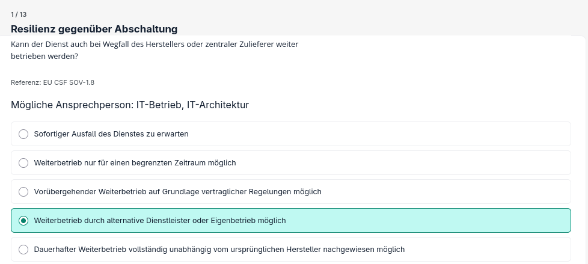

Operaton ist Free und Open Source und nicht an einen Hersteller gebunden. Es wird durch die Community getrieben und weiterentwickelt, darunter mehrere Firmen und Dienstleister welche es entweder intern nutzen oder Kunden mit der Software versorgen. Sämtliche Komponenten sind Open Source, Operaton enthält keinerlei proprietäre Features, welche bei Wegfall des Zulieferers nicht weiter gewartet werden können. Ein Weiterbetrieb in Eigentwicklung oder Einspringen eines der beteiligten Unternehmen ist nahezu sicher – einen Nachweis für die volle Punktzahl würden wir gern unterstützen. 

## Rechtliche Souveränität

### Rechtshohheit

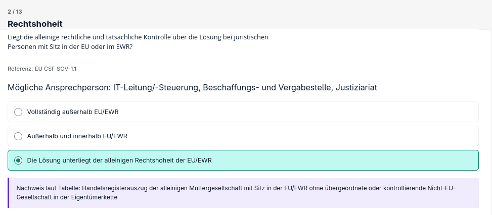

Diese Frage passt auf communitygetriebenes Open Source meiner Meinung nach nur bedingt. Die Antwort nimmt ein wenig Zeit vorweg, denn es befindet sich ein Verein in Gründung, welcher Trademarks, Domains und Schlüssel zu den wichtigen Plattformen halten wird, dieser wird in Deutschland angemeldet sein. 

## Souveränität von Daten und KI

### Schlüsselkontrolle

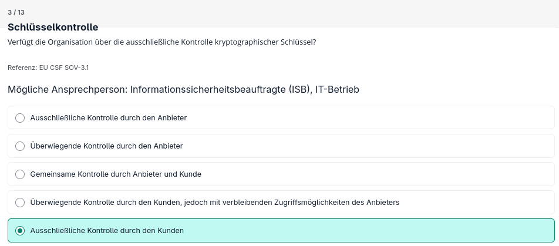

Operaton ist eine Open Source Software welche als Library, als Runtime wie Wildfly oder Tomcat, oder als Docker Container betrieben wird. Sämtliche Entwicklung und sämtlicher Betrieb erfolgen on premise und durch die Nutzenden. 

### Datenlokation

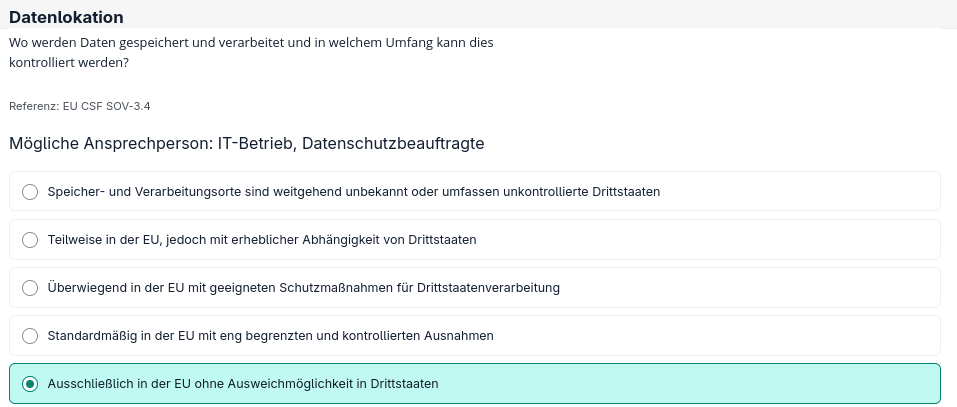

Operaton wird üblicherweise on Premise betrieben, die Nutzenden haben komplette Hohheit über alle Daten

### KI (seufz)

Operaton hat keine eingebauten KI Features - es ist erweiterbar, KI kann durch verschiedene Mechanismen wie Spring AI, External Service Tasks oder Integration in einer Java Applikation eingebunden werden. Auf welche Art und Weise die Nutzenden KI verwenden können gibt die Workflow Engine nicht vor.

## Operative Souveränität

### Portabilität und Interoperabilität

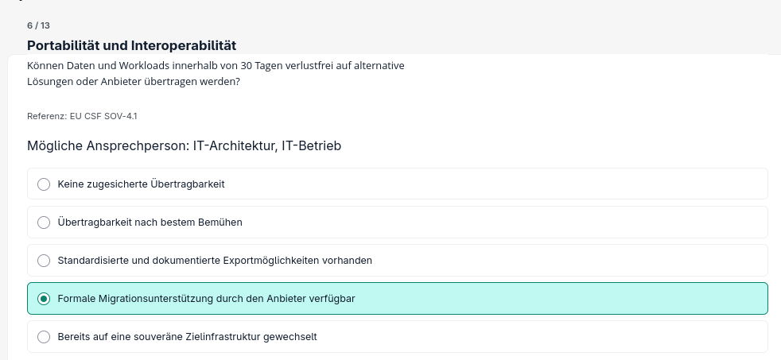

Frage 6 ist in unserem Fall etwas schwammig zu beantworten. Es existieren, so wie Operaton es auch ist, mehrere Forks von Camunda 7. Wie uns mehrere Unternehmen schon bestätigten, *war* Operaton die souveräne Zielinfrastruktur beim Wechsel von Camunda 7, oft innerhalb weniger Tage, und ohne Datenverlust oder Unterbrechung der Prozessausführung. 

### Dokumentation und Wissenstransfer

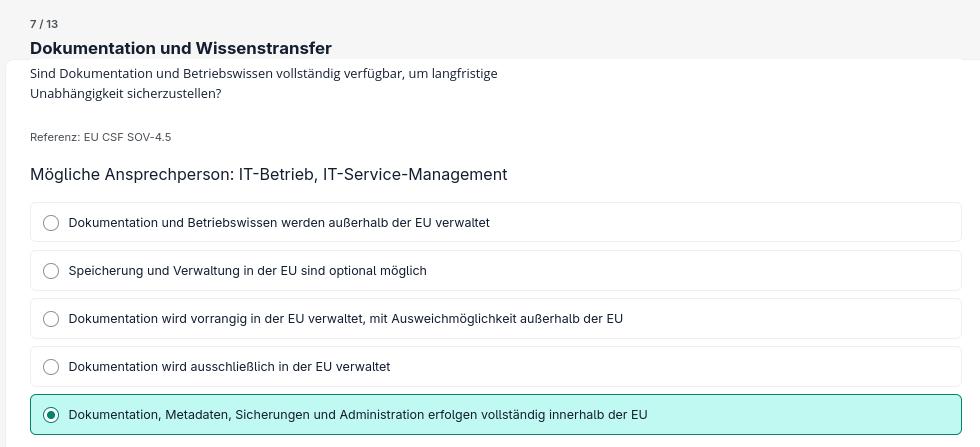

Unsere Dokumentation befindet sich auf [docs.operaton.org](https://docs.operaton.org) und ist frei verfügbar. Auch dieses Repository wird den in Gründung befindlichen Verein gehören, welcher in Deutschland verortet sein wird. Sämtliche Dokumentation ist frei verfügbar.

### Supplier & Subcontractor Sovereignity

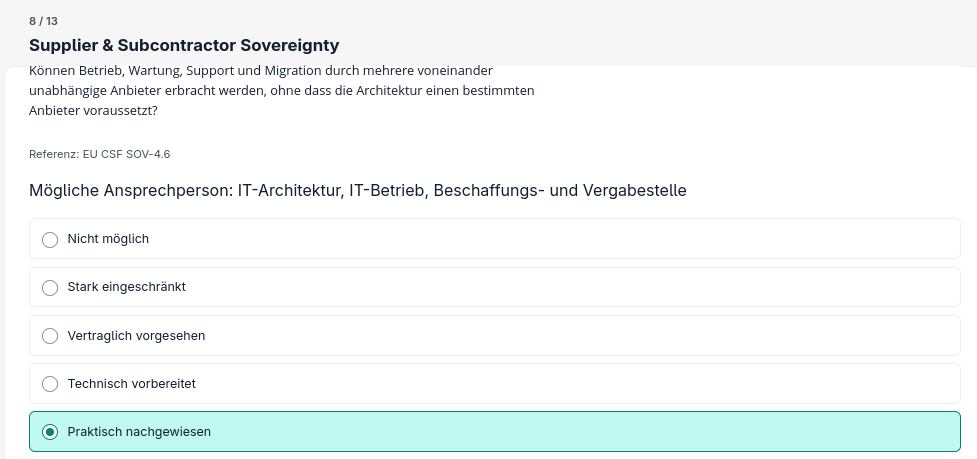

Es existieren, neben der [Otus GmbH](https://otus.gmbh/de/operaton-enterprise-support) (verzeiht mir die Werbung) noch mehrere Unternehmen, welche Support für Operaton anbieten, einige davon sind auf [der Website des Projekts](https://operaton.org/service-providers/) gelistet. Dieses Vorgehen orientiert sich an anderen bekannten Open Source Projekten, etwa PostgreSQL oder Tomcat. Kunden können den Supportanbieter einer laufenden Installation ändern, ohne, dass auch nur eine Anpassung vorgenommen werden müsste. 

## Lieferkettensouveränität

### Herkunft der Software

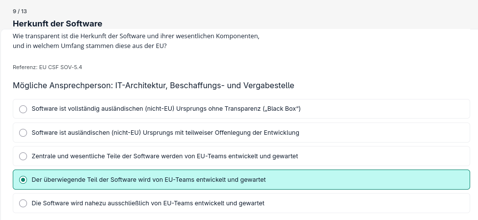

Auch diese Frage ist aus der Perspektive eines communitygetriebenen Open Source Projekts schwierig zu beantworten. Selbstverständlich erlauben wir auch Contributions aus nicht-EU Ländern, die Core Maintainer sind gegenwärtig aber alle mit Sitz in Deutschland, und die Schlüssel für Deployments werden künftig beim Verein in Deutschland liegen.

### Technologische Abhängigkeit

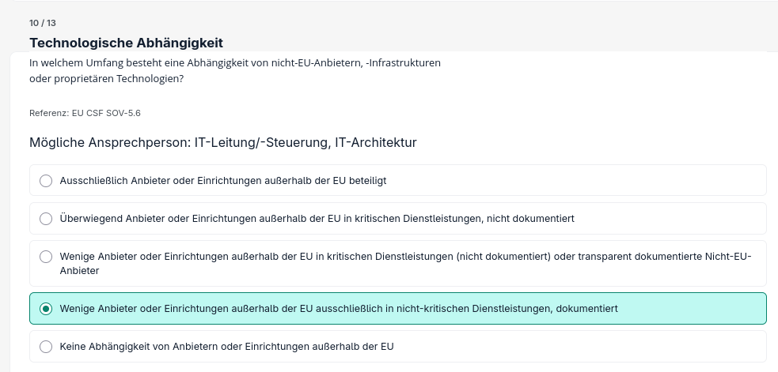

Operaton wird auf GitHub gehostet und stellt seine Artefakte im Maven Central Repository von Sonatype bereit. Unsere Docker Images liegen im Dockerhub. Dies würde ich persönlich als unterstützende Infrastruktur für die Entwicklung des Projekts einschätzen - jedoch würden sich diese auch mit mittlerem bis geringem Aufwand ersetzen lassen. Die eigentliche Software hat keinerlei Abhängigkeiten außerhalb der EU.

### Transparenz der Lieferkette

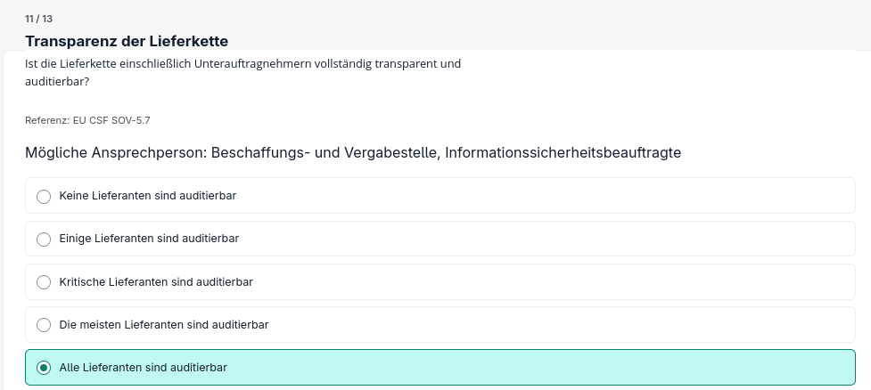

Und schon wieder: Operaton ist ein communitygetriebenes Open Source Projekt. Als Lieferkette und nachgelagerte Lieferanten könnte man hier, neben den Dienstleister und Supportanbietern direkt, auch Open Source Dependencies sehen. Diese sind mit kontinuierlich aktualisierten SBOM durchgehend nachgewiesen und dokumentiert.

## Technologische Souveränität

### Offene Standards und Schnittstellen

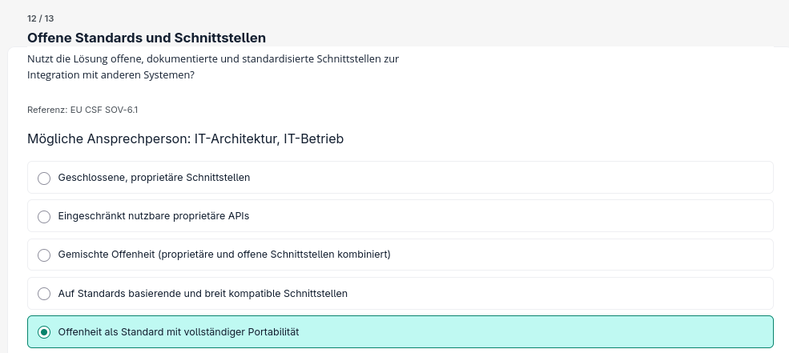

Operaton bietet eine REST API und eine gut dokumentierte JAVA API an. Diese API sind durch Plugins und Eigenentwicklung erweiterbar. In der anderen Richtung ist jeglicher Java (und polyglotter) Code aus Operaton heraus nutzbar, alle Systeme welche mit Java angebunden werden können, können auch mit Operaton angebunden werden.

### Verfügbarkeit von Open Source

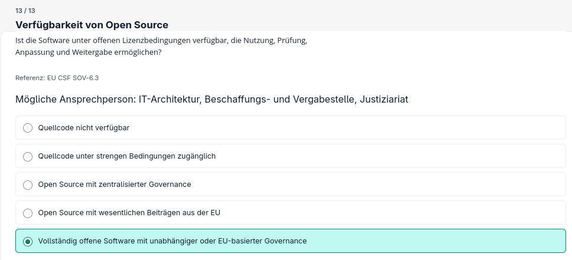

Kommt schon – wenn ihr bis hier hin gelesen habt, dürfte die Antwort euch doch klar sein? Operaton ist vollkommen Open Source. Es existieren keine proprietären Komponenten, und es gibt für Contributoren keine Dual Licensing Agreements. Es ist uns faktisch nicht möglich, den Operaton Code von Apache 2.0 zu einer weniger offenen Lizenz zu ändern, wir würden das Einverständnis aller bisherigen Committer benötigen - nahezu ausgeschlossen.

Und nur eine Frage zu Open Source? Ich hoffe, das gibt nicht nur einen Punkt von 13 ;) 

## Das Ergebnis

Lässt man sich aus diesen 13 Antworten das Ergebnis berechnen, erhält man einen SEAL Wert, welcher (nach meinem Verständnis) der schwächsten Antwort entspricht. In unserem Falle wäre das SEAL 2, da das schwächste Ergebnis die Frage 1, "Resilienz gegenüber Abschaltung", einen Score von 2 hat. Faktisch ist der Weiterbetrieb problemlos möglich - und sollten wir endlich den richtigen Ansprechpartner finden, um Operaton in OpenCode spiegeln zu dürfen, würde ich uns hier ebenfalls die volle Punktzahl geben ;)

## Reflektion

Möglicherweise bewerte ich hier aus eigenem Bias zu positiv, aber aus meiner Sicht existiert mit dem Blick auf digitale Souveränität gegenwärtig keine Prozessengine aus der Activiti Erbfolge (also Forks von Activiti und deren Forks, so wie Operaton einer ist), welche besser für einen digital souveränen Betrieb geeignet sind. Schreibt mir gerne auf Mastodon, LinkedIn oder per Email (siehe Footer) eure Gedanken, Fragen und Kommentare dazu.
